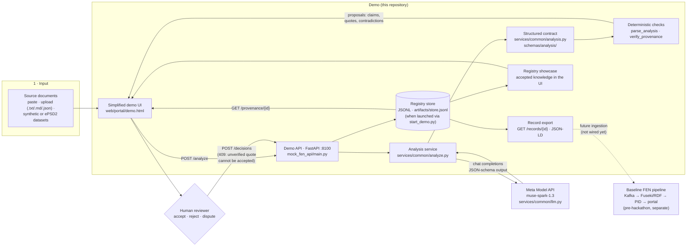

# FEN × Meta — Human-Governed AI Synthesis

**AI proposes. Humans decide. Every decision keeps its provenance.**

**Live demo: https://fen-meta-synthesis.vercel.app/demo** — the simplified
one-screen demo (sources → proposals → quote check → your decision); the
full Review screen is at `/review`. (The hosted page is the static UI;
running an analysis needs the local backend —
`python scripts/start_demo.py`, see [DEMO.md](DEMO.md).)

FEN × Meta extends the open-source FEN Triadic Synthesis research prototype
for the Meta Global AI Developer Hackathon. It adds one focused, end-to-end
workflow: a Meta model reads several source documents, extracts claims with
verbatim quotes, flags contradictions between sources, and hands the result
to a human reviewer. The reviewer accepts, rejects, or disputes each item,
and the decision is recorded together with the source, the model, and the
prompt that produced the proposal.

Status: work in progress during the hackathon. See
[Project status](#project-status) for what is implemented, what is planned,
and what remains simulated.

## The problem

Researchers who work with conflicting sources (for example, different
dictionaries or archives that define the same term differently) spend hours
reconciling them by hand. A general-purpose chatbot can summarize the
sources, but it hides where each statement came from and can invent quotes.
FEN × Meta keeps the model in the role of an assistant: it can only
recommend, every recommendation points to an exact quote, and a human holds
the final decision.

## How it works

```text
documents ──► Meta model ──► structured analysis ──► deterministic checks ──► human review ──► registry
              (claims,         (claims, quotes,       (quote located in       (accept /        (decision +
               contradictions)  contradictions)        its source)             reject /         provenance)
                                                                               dispute)
```

- **Input.** Two or three source documents, each with a `document_id`.
- **Analysis.** A Meta model returns JSON: atomic claims — each with a
  verbatim `quote`, a `statement` of the claim, and the model's
  `interpretation` kept separate from the claim itself, plus stated
  `ambiguities`, an `uncertainty` level
  (`low | medium | high | insufficient_evidence`) and a review
  recommendation — and contradictions between claims, including alternative
  interpretations ("this may not be a conflict if…").
- **Checks without the model.** The system verifies that every quote can be
  located in its source document (exact or whitespace-normalised substring),
  that every contradiction references existing claims, and that claim and
  contradiction identifiers are unique. Provenance therefore does not
  depend on trusting the model. (SHACL validation applies to the baseline
  scaffolding triples, not to analysis claims.)
- **Human review.** The reviewer sees each proposal with its exact source
  quote and its verification status. A claim whose quote cannot be verified
  is marked red and **cannot be accepted** (the UI disables Accept and the
  API returns 409).
- **Record.** The decision is stored with the reviewer, verdict, comment,
  timestamp, model, and prompt hash, and is published as a `review-decision`
  event (demo event log / injectable publisher in this hackathon build —
  see [Limitations](#limitations)).

The model never sets a final status. `accepted`, `rejected`, and `disputed`
exist only after a human decision.

## Implementation map — demo, repository, development setup

The diagram shows what actually runs in the demo today. Solid paths are
implemented and tested; the dashed path is the pre-existing baseline
pipeline, which is **not** wired into the hackathon decisions yet.



| Part | Where it lives | Status |
|---|---|---|
| Simplified one-screen demo (sources → proposals → decision → registry) | [web/portal/demo.html](web/portal/demo.html), [demo.js](web/portal/demo.js) | Done |
| Full Review screen (same workflow, all panels) | [web/portal/review.html](web/portal/review.html), [review.js](web/portal/review.js) | Done |
| Candidate detail page for voters | [web/portal/candidate.html](web/portal/candidate.html) | Done |
| Analysis workflow (prompt → parse → provenance) | [services/common/analyze.py](services/common/analyze.py), [services/common/analysis.py](services/common/analysis.py) | Done |
| Meta client (retries, JSON mode, structured output, usage capture) | [services/common/llm.py](services/common/llm.py), [docs/PROVIDERS.md](docs/PROVIDERS.md) | Done |
| Demo API (`/analyze`, `/decisions`, `/provenance`, `/registry`, `/records`) | [mock_fen_api/main.py](mock_fen_api/main.py), [decisions.py](mock_fen_api/decisions.py), [store.py](mock_fen_api/store.py) | Done |
| Decision persistence across restarts (JSONL append-only) | `artifacts/store.jsonl` via `FEN_STORE_PATH` ([scripts/start_demo.py](scripts/start_demo.py)) | Done (demo scope) |
| Evaluation harness (metrics, B0 baseline, provider comparison) | [eval/run_eval.py](eval/run_eval.py), [eval/REPORT.md](eval/REPORT.md) | Done; corpus runs Planned |
| Lemma candidates checked against ePSD2 | [eval/candidates/](eval/candidates/sumerian-video-candidates.json), [eval/dataset/SOURCES.md](eval/dataset/SOURCES.md) | Done; gold dataset Planned |
| Baseline Kafka → RDF → PID pipeline | `services/fen_bridge/`, `services/validation_consumer/`, `services/status_api/` | Done (baseline); integration with decisions Planned |
| DAO / Quadratic Voting, ledger anchors | `mock_fen_api/` | Simulated |

### Development setup

```bash
git clone https://github.com/riznykst/fen-meta-synthesis
cd fen-meta-synthesis

# Demo (no Docker): configure Meta once, then one command
cp .env.example .env        # set FEN_LLM_BASE_URL / FEN_LLM_API_KEY / FEN_LLM_MODEL
python scripts/start_demo.py
# open http://127.0.0.1:8082/web/portal/demo.html

# Tests
pip install -r requirements-common.txt
python -m pytest -q                 # 218 tests
node --test web/tests/*.test.js     # UI pure-function tests
# from web/: npx playwright test    # browser e2e (needs the local stack)

# Evaluation
python eval/validate_dataset.py
python eval/run_eval.py --provider meta     # needs a labelled dataset
python eval/run_eval.py --provider fixture  # offline SYNTHETIC smoke

# Full pre-hackathon stack (Kafka, Fuseki, all baseline services)
docker compose up
```

Deployment: the static web layer is deployed by Vercel from this
repository (`vercel.json` rewrites; live demo at
https://fen-meta-synthesis.vercel.app/demo). The Python backend runs
locally for the demo; no public backend is claimed.

## What is new in this hackathon

| Area | Contribution |
|---|---|
| Meta integration | Calls to the Meta Model API through the existing OpenAI-compatible client; request, response, returned model, and token usage are captured in sanitised artifacts (kept local until human-reviewed, see [HACKATHON.md](HACKATHON.md)) |
| Analysis contract | Pydantic models and a generated JSON Schema for claims, contradictions, and quotes ([services/common/analysis.py](services/common/analysis.py), [schemas/analysis/](schemas/analysis/)) |
| Provenance checks | Verbatim quote verification and contradiction integrity checks ([services/common/analyze.py](services/common/analyze.py)) |
| Review screen | A lightweight review interface built on the existing static portal ([web/portal/review.html](web/portal/review.html)) |
| Decision trail | Recording of reviewer decisions and a provenance chain from source to decision (`POST /decisions`, `GET /provenance/{item_id}`) |
| Evaluation | An evaluation runner and report ([eval/](eval/)) over a human-labelled test set once the human supplies it |

## Project status

Legend: **Done** is implemented and covered by tests. **In progress** and
**Planned** are not yet claimed as working. **Simulated** means it exists
only as a stand-in.

| Component | Status |
|---|---|
| Kafka → RDF registry → PID → web portal pipeline (pre-hackathon baseline) | Done |
| Agentic scaffolding of a single statement into a triple with SHACL validation (baseline) | Done |
| Simulated DAO voting (quadratic voting) (baseline) | Simulated |
| Analysis contract and quote verification | Done — implemented **during** the hackathon (see boundary note below) |
| Live call to the Meta Model API through FEN | Done — verified live on 2026-10-28 (`muse-spark-1.3`); artifacts local pending human-reviewed commit |
| `POST /analyze` endpoint | Done |
| Review screen | Done |
| Decision recording and provenance endpoint | Done (JSONL-persistent demo registry via `start_demo.py`; in-memory otherwise) |
| Evaluation harness and B0 baseline | Done |
| Evaluation on the human-labelled corpus; Baseten B1 comparison | Planned — awaiting dataset (T8) and provider access |

This table is updated with every task commit. Nothing is listed as done
without a test or a reproducible run. Current suites in this repository:
**218 pytest + 116 Node tests + Playwright e2e (Review, Demo, Registry,
Candidate)**, all passing (baseline was 125 + 18). The one Playwright test
that needs the full pre-hackathon pipeline (webhook + Kafka) skips itself
with an explicit reason when that stack is not running.

## Before vs. during the hackathon

FEN Triadic Synthesis existed as a public research prototype before the
hackathon. To keep the boundary verifiable:

- The git tag `baseline-pre-hackathon` marks the last commit before the
  development period (`8c1164d`).
- An earlier draft of this README described the analysis contract and a
  review-screen mock-up as drafted before the development period. **The
  repository audit did not confirm that**: no such patch or files existed
  at the baseline (recorded as Q1 in
  [docs/OPEN_QUESTIONS.md](docs/OPEN_QUESTIONS.md)). The analysis contract,
  its JSON Schema and tests, and the Review screen were therefore
  implemented **during** the hackathon and are not claimed as prior work.
- [HACKATHON.md](HACKATHON.md) lists, per commit, what belongs to which
  side of the boundary.
- Features that are not fully integrated are labelled simulated or planned.

## Quick start

Requirements: Python 3.10+ (verified locally on 3.10.4), Node.js 22, and
Docker only for the full pre-hackathon stack.

```bash
git clone https://github.com/riznykst/fen-meta-synthesis
cd fen-meta-synthesis

pip install -r requirements-common.txt
python -m pytest -q
node --test web/tests/*.test.js
```

Three-minute demo (no Docker, no Kafka needed):

```bash
python scripts/start_demo.py
# open http://127.0.0.1:8082/web/portal/review.html and follow DEMO.md
```

Full stack (Kafka, Fuseki, services, portal):

```bash
docker compose up
```

## Configuring the model provider

The LLM client works with any OpenAI-compatible endpoint. Set these
variables in your environment (never commit them):

```bash
export FEN_LLM_BASE_URL="https://api.meta.ai/v1"   # Meta Model API (confirmed live 2026-10-28)
export FEN_LLM_API_KEY="<your key>"
export FEN_LLM_MODEL="muse-spark-1.3"              # confirmed in the provider dashboard and by live calls
```

Switching between the Meta Model API and an open-weights deployment is a
configuration change; see [docs/PROVIDERS.md](docs/PROVIDERS.md).

## Evaluation

The evaluation harness lives in [eval/](eval/). It measures, on a small
hand-labelled set of source documents (supplied by the human — the agent
never invents corpus data):

- **JSON validity rate:** how often the model returns a parseable analysis.
- **Quote verification rate:** the share of claims whose quote is located
  in the source.
- **Claim recall and precision** against the labelled claims.
- **Contradiction recall and false-positive rate** against the labelled
  contradictions.

It also reports how many fabricated quotes would have passed without the
provenance check (the **B0** baseline), which is the comparison that shows
what the verification layer adds. Results, the test-set size, the model,
and the date are published in [eval/REPORT.md](eval/REPORT.md).

A first candidate register — lecture-derived lemmas (`lu`, `bahar`, `me`)
checked against ePSD2 — lives in
[eval/candidates/sumerian-video-candidates.json](eval/candidates/sumerian-video-candidates.json).
It is provenance for future examples, not gold data. So far the
harness has been run on a clearly labelled synthetic smoke example only;
**no corpus figures are reported until they are measured** on the
human-supplied dataset.

## Repository layout

```text
services/common/        LLM client, analysis contract, provenance checks
mock_fen_api/           API for the demo, including scaffolding
schemas/kafka-events/   Existing event schemas (unchanged)
schemas/analysis/       New analysis schemas (generated from the models)
web/                    Static portal and review screen
eval/                   Test set, runner, and report
tests/                  pytest suite
docs/                   ADRs, provider notes
```

## Design principles

- **AI recommends, humans decide.** This follows the project's existing
  architecture decision (ADR-004).
- **Evidence over assertion.** A claim without a verifiable quote cannot be
  accepted.
- **Uncertainty is shown, not hidden.** Alternative interpretations are
  part of the output.
- **No canned model output in the working path.** Test fixtures are
  labelled RECORDED or SYNTHETIC.

## Limitations

- The check confirms that a quote exists in the source, not that the model
  understood it correctly. Reviewers still judge meaning.
- Contradiction detection depends on the model and is measured only on a
  small test set.
- Quote matching normalizes whitespace but is case- and
  punctuation-sensitive in its exact form (a token-overlap rule is used
  only for evaluation matching).
- Voting and reputation mechanisms from the baseline remain simulated.
- The hackathon decision registry is a demo-scope JSONL store when
  launched via `scripts/start_demo.py` (in-memory otherwise), and
  decisions are published to a demo event log / injectable publisher —
  wiring them into the Kafka governance pipeline is not claimed.
- Live-response artifacts are kept local until a human reviews them for
  commit.

## Data and licensing

Source texts and licences are registered in
[eval/dataset/SOURCES.md](eval/dataset/SOURCES.md). That register exists;
the human-supplied corpus texts themselves are not in the repository yet
(the dataset gate is [eval/validate_dataset.py](eval/validate_dataset.py)).
Check each source's license before reuse.

## License

See [LICENSE](LICENSE).

## Acknowledgements

Built for the Meta Global AI Developer Hackathon. The baseline FEN Triadic
Synthesis prototype is by its original author; see the repository history
for details.
