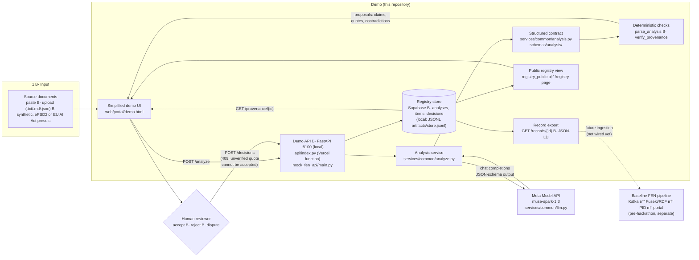

# FEN × Meta — Human-Governed AI Synthesis

**AI proposes. Humans decide. Every decision keeps its provenance.**

**Live demo: https://fen-meta-synthesis.vercel.app/demo** — the simplified
one-screen demo (sources в†’ proposals в†’ quote check в†’ your decision); the full
Review screen is at `/review`, the public registry of accepted knowledge at
`/registry`, and the user wiki at `/faq`. It runs end to end on Vercel: a Python
function at `api/index.py` calls the Meta Model API and stores analyses, items
and human verdicts in Supabase, so nothing needs to be started locally.

**Demo video (1:56): https://youtu.be/yomKcH8iZN4**

Three datasets ship with the demo: a synthetic trade-route story, ePSD2
dictionary excerpts for Sumerian lemmas, and EU AI Act Articles 11, 12 and 18
from EUR-Lex (the demo uses 11 and 18) with one clearly SYNTHETIC commentary
paragraph — see [Datasets](#datasets).

Prefer to run it on your machine? `python scripts/start_demo.py` brings up the
same API against a local JSONL store — see [DEMO.md](DEMO.md).

FEN Г— Meta extends the open-source FEN Triadic Synthesis research prototype
for the Meta Global AI Developer Hackathon. It adds one focused, end-to-end
workflow: a Meta model reads several source documents, extracts claims with
verbatim quotes, flags contradictions between sources, and hands the result
to a human reviewer. The reviewer accepts, rejects, or disputes each item,
and the decision is recorded together with the source, the model, and the
prompt that produced the proposal.

Status: hackathon submission build (4 November 2026). See
[Project status](#project-status) for what is implemented, what is planned,
and what remains simulated.

## The problem

Researchers who work with conflicting sources (for example, different
dictionaries or archives that define the same term differently) spend hours
reconciling them by hand. A general-purpose chatbot can summarize the
sources, but it hides where each statement came from and can invent quotes.
FEN Г— Meta keeps the model in the role of an assistant: it can only
recommend, every recommendation points to an exact quote, and a human holds
the final decision.

## How it works

```text
documents в”Ђв”Ђв–є Meta model в”Ђв”Ђв–є structured analysis в”Ђв”Ђв–є deterministic checks в”Ђв”Ђв–є human review в”Ђв”Ђв–є registry
              (claims,         (claims, quotes,       (quote located in       (accept /        (decision +
               contradictions)  contradictions)        its source)             reject /         provenance)
                                                                               dispute)
```

- **Input.** Two or three source documents, each with a `document_id`.
- **Analysis.** A Meta model returns JSON: atomic claims — each with a
  verbatim `quote`, a `statement` of the claim, and the model's
  `interpretation` kept separate from the claim itself, plus stated
  `ambiguities`, an `uncertainty` level
  (`low | medium | high | insufficient_evidence`) and a review
  recommendation — and contradictions between claims, including alternative
  interpretations ("this may not be a conflict if…").
- **Checks without the model.** The system verifies that every quote can be
  located in its source document (exact or whitespace-normalised substring),
  that every contradiction references existing claims, and that claim and
  contradiction identifiers are unique. Provenance therefore does not
  depend on trusting the model. (SHACL validation applies to the baseline
  scaffolding triples, not to analysis claims.)
- **Human review.** The reviewer sees each proposal with its exact source
  quote and its verification status. A claim whose quote cannot be verified
  is marked red and **cannot be accepted** (the UI disables Accept and the
  API returns 409).
- **Record.** The decision is stored with the reviewer, verdict, comment,
  timestamp, model, and prompt hash, and is published as a `review-decision`
  event (demo event log / injectable publisher in this hackathon build —
  see [Limitations](#limitations)).

The model never sets a final status. `accepted`, `rejected`, and `disputed`
exist only after a human decision.

## Implementation map — demo, repository, development setup

The diagram shows what actually runs in the demo today. Solid paths are
implemented and tested; the dashed path is the pre-existing baseline
pipeline, which is **not** wired into the hackathon decisions yet.



| Part | Where it lives | Status |
|---|---|---|
| Simplified one-screen demo (sources в†’ proposals в†’ decision в†’ registry) | [web/portal/demo.html](web/portal/demo.html), [demo.js](web/portal/demo.js) | Done |
| Full Review screen (same workflow, all panels) | [web/portal/review.html](web/portal/review.html), [review.js](web/portal/review.js) | Done |
| Candidate detail page for voters | [web/portal/candidate.html](web/portal/candidate.html) | Done |
| Analysis workflow (prompt в†’ parse в†’ provenance) | [services/common/analyze.py](services/common/analyze.py), [services/common/analysis.py](services/common/analysis.py) | Done |
| Meta client (retries, JSON mode, structured output, usage capture) | [services/common/llm.py](services/common/llm.py), [docs/PROVIDERS.md](docs/PROVIDERS.md) | Done |
| Demo API (`/analyze`, `/decisions`, `/provenance`, `/registry`, `/records`) | [mock_fen_api/main.py](mock_fen_api/main.py), [decisions.py](mock_fen_api/decisions.py), [store.py](mock_fen_api/store.py) | Done |
| Serverless entry for the live site (same app, routed via `?r=/analyze`) | [api/index.py](api/index.py), [mock_fen_api/serverless.py](mock_fen_api/serverless.py) | Done |
| Durable registry: schema, RLS, append-only decisions, `record_decision()` | [supabase/migrations/](supabase/migrations/), [supabase/README.md](supabase/README.md) | Applied |
| Public registry page (accepted knowledge only, publishable key) | [web/portal/registry.html](web/portal/registry.html), [web/shared/supabase.js](web/shared/supabase.js) | Done |
| Source provenance (primary / secondary / synthetic) end to end | [services/common/analysis.py](services/common/analysis.py), migration `0003` | Done |
| Decision persistence across restarts (JSONL append-only) | `artifacts/store.jsonl` via `FEN_STORE_PATH` ([scripts/start_demo.py](scripts/start_demo.py)) | Done (local demo scope) |
| Evaluation harness (metrics, B0 baseline, provider comparison) | [eval/run_eval.py](eval/run_eval.py), [eval/REPORT.md](eval/REPORT.md) | Done; corpus runs Planned |
| Lemma candidates checked against ePSD2 | [eval/candidates/](eval/candidates/sumerian-video-candidates.json), [eval/dataset/SOURCES.md](eval/dataset/SOURCES.md) | Done; gold dataset Planned |
| Baseline Kafka в†’ RDF в†’ PID pipeline | `services/fen_bridge/`, `services/validation_consumer/`, `services/status_api/` | Done (baseline); integration with decisions Planned |
| DAO / Quadratic Voting, ledger anchors | `mock_fen_api/` | Simulated |

### Development setup

```bash
git clone https://github.com/riznykst/fen-meta-synthesis
cd fen-meta-synthesis

# Demo (no Docker): configure Meta once, then one command
cp .env.example .env        # set FEN_LLM_BASE_URL / FEN_LLM_API_KEY / FEN_LLM_MODEL
python scripts/start_demo.py
# open http://127.0.0.1:8082/web/portal/demo.html

# Tests
pip install -r requirements-common.txt
python -m pytest -q                 # 219 tests
node --test web/tests/*.test.js     # UI pure-function tests
# from web/: npx playwright test    # browser e2e (needs the local stack)

# Evaluation
python eval/validate_dataset.py
python eval/run_eval.py --provider meta     # needs a labelled dataset
python eval/run_eval.py --provider fixture  # offline SYNTHETIC smoke

# Full pre-hackathon stack (Kafka, Fuseki, all baseline services)
docker compose up
```

Deployment: Vercel serves the static web layer (`vercel.json` rewrites) **and**
the serverless demo API ([api/index.py](api/index.py)), which reads the Meta key
and the Supabase connection from Vercel environment variables. The same code
also runs locally (`python scripts/start_demo.py`) against a JSONL store, which
is what the offline test suite uses. The public surface is read-only: the
publishable key can select from the `registry_public` view only — source texts
and undecided proposals stay private (see [supabase/README.md](supabase/README.md)).

## What is new in this hackathon

| Area | Contribution |
|---|---|
| Meta integration | Calls to the Meta Model API through the existing OpenAI-compatible client; request, response, returned model, and token usage are captured in sanitised artifacts (kept local until human-reviewed, see [HACKATHON.md](HACKATHON.md)) |
| Analysis contract | Pydantic models and a generated JSON Schema for claims, contradictions, and quotes ([services/common/analysis.py](services/common/analysis.py), [schemas/analysis/](schemas/analysis/)) |
| Provenance checks | Verbatim quote verification and contradiction integrity checks ([services/common/analyze.py](services/common/analyze.py)) |
| Review screen | A lightweight review interface built on the existing static portal ([web/portal/review.html](web/portal/review.html)) |
| Decision trail | Recording of reviewer decisions and a provenance chain from source to decision (`POST /decisions`, `GET /provenance/{item_id}`) |
| Durable registry | Supabase schema with row-level security, append-only decisions enforced by a trigger, and a server-side `record_decision()` that refuses to accept an unverified quote ([supabase/](supabase/)) |
| Public registry surface | `/registry` page reading the accepted-knowledge view with a publishable key; source texts and undecided proposals stay private |
| Source provenance | Documents declare `primary` / `secondary` / `synthetic`; the claim inherits it, the database stores it, the UI badges it |
| Second domain | EU AI Act Articles 11/12/18 from EUR-Lex plus a SYNTHETIC commentary, used to show a real wrong-attribution case ([Datasets](#datasets)) |
| Evaluation | An evaluation runner and report ([eval/](eval/)) over a human-labelled test set once the human supplies it |

## Project status

Legend: **Done** is implemented and covered by tests. **In progress** and
**Planned** are not yet claimed as working. **Simulated** means it exists
only as a stand-in.

| Component | Status |
|---|---|
| Kafka в†’ RDF registry в†’ PID в†’ web portal pipeline (pre-hackathon baseline) | Done |
| Agentic scaffolding of a single statement into a triple with SHACL validation (baseline) | Done |
| Simulated DAO voting (quadratic voting) (baseline) | Simulated |
| Analysis contract and quote verification | Done — implemented **during** the hackathon (see boundary note below) |
| Live call to the Meta Model API through FEN | Done — verified live on 2026-10-28 (`muse-spark-1.3`); artifacts local pending human-reviewed commit |
| `POST /analyze` endpoint | Done |
| Review screen | Done |
| Decision recording and provenance endpoint | Done — Supabase on the live site, append-only JSONL when run locally |
| Public registry of accepted knowledge (`/registry`) | Done — reads the `registry_public` view; auto-refreshes every 20 s |
| Source provenance (primary / secondary / synthetic) | Done — per document, echoed on each claim, persisted, badged in the UI |
| EU AI Act dataset (Articles 11/12/18 from EUR-Lex + SYNTHETIC commentary) | Done as a demo dataset; gold example is a draft pending human verification |
| Evaluation harness and B0 baseline | Done |
| Evaluation on the human-labelled corpus; Baseten B1 comparison | Planned — awaiting dataset (T8) and provider access |

This table is updated with every task commit. Nothing is listed as done
without a test or a reproducible run. Current suites in this repository:
**219 pytest + 116 Node tests + Playwright e2e (Demo, Review, Registry, FAQ,
Candidate)**, all passing (baseline was 125 + 18). The one Playwright test
that needs the full pre-hackathon pipeline (webhook + Kafka) skips itself
with an explicit reason when that stack is not running.

## Before vs. during the hackathon

FEN Triadic Synthesis existed as a public research prototype before the
hackathon. To keep the boundary verifiable:

- The git tag `baseline-pre-hackathon` marks the last commit before the
  development period (`8c1164d`).
- An earlier draft of this README described the analysis contract and a
  review-screen mock-up as drafted before the development period. **The
  repository audit did not confirm that**: no such patch or files existed
  at the baseline (recorded as Q1 in
  [docs/OPEN_QUESTIONS.md](docs/OPEN_QUESTIONS.md)). The analysis contract,
  its JSON Schema and tests, and the Review screen were therefore
  implemented **during** the hackathon and are not claimed as prior work.
- [HACKATHON.md](HACKATHON.md) lists, per commit, what belongs to which
  side of the boundary.
- Features that are not fully integrated are labelled simulated or planned.

## Quick start

Requirements: Python 3.10+ (verified locally on 3.10.4), Node.js 22, and
Docker only for the full pre-hackathon stack.

```bash
git clone https://github.com/riznykst/fen-meta-synthesis
cd fen-meta-synthesis

pip install -r requirements-common.txt
python -m pytest -q
node --test web/tests/*.test.js
```

Three-minute demo (no Docker, no Kafka needed):

```bash
python scripts/start_demo.py
# open http://127.0.0.1:8082/web/portal/demo.html and follow DEMO.md
```

Full stack (Kafka, Fuseki, services, portal):

```bash
docker compose up
```

## Configuring the model provider

The LLM client works with any OpenAI-compatible endpoint. Set these
variables in your environment (never commit them):

```bash
export FEN_LLM_BASE_URL="https://api.meta.ai/v1"   # Meta Model API (confirmed live 2026-10-28)
export FEN_LLM_API_KEY="<your key>"
export FEN_LLM_MODEL="muse-spark-1.3"              # confirmed in the provider dashboard and by live calls
```

Switching between the Meta Model API and an open-weights deployment is a
configuration change; see [docs/PROVIDERS.md](docs/PROVIDERS.md).

## Evaluation

The evaluation harness lives in [eval/](eval/). It measures, on a small
hand-labelled set of source documents (supplied by the human — the agent
never invents corpus data):

- **JSON validity rate:** how often the model returns a parseable analysis.
- **Quote verification rate:** the share of claims whose quote is located
  in the source.
- **Claim recall and precision** against the labelled claims.
- **Contradiction recall and false-positive rate** against the labelled
  contradictions.

It also reports how many fabricated quotes would have passed without the
provenance check (the **B0** baseline), which is the comparison that shows
what the verification layer adds. Results, the test-set size, the model,
and the date are published in [eval/REPORT.md](eval/REPORT.md).

A first candidate register — lecture-derived lemmas (`lu`, `bahar`, `me`)
checked against ePSD2 — lives in
[eval/candidates/sumerian-video-candidates.json](eval/candidates/sumerian-video-candidates.json).
It is provenance for future examples, not gold data. So far the
harness has been run on a clearly labelled synthetic smoke example only;
**no corpus figures are reported until they are measured** on the
human-supplied dataset.

## Datasets

Three presets ship with the demo; switching one replaces the documents in the
form, and the rest of the pipeline is identical.

| Preset | What it contains | Licence |
|---|---|---|
| Demo (synthetic) | An invented trade-route story | none needed — SYNTHETIC |
| Sumerian dictionary entries (ePSD2) | Verified excerpts for `lu`, `bahar`, `me` | CC BY-SA 3.0 (Oracc) |
| EU AI Act — public texts (not legal advice) | Articles 11, 12, 18 of Regulation (EU) 2024/1689 + one SYNTHETIC commentary | EUR-Lex reuse policy (Commission Decision 2011/833/EU) with attribution |

The EU AI Act preset exists to demonstrate a wrong attribution: the
commentary repeats a ten-year retention rule that belongs to Article 18 but
attributes it to Article 11. The verified texts contain no such rule in
Article 11, and a test asserts exactly that (`web/tests/demo.test.js`), so the
case cannot be faked by editing the documents. `eval/dataset/eu-ai-act/example.json`
is a **draft** gold example — the quotes are verbatim, but the gold claims still
need human confirmation.

## Repository layout

```text
services/common/        LLM client, analysis contract, provenance checks
mock_fen_api/           API for the demo, including scaffolding
api/                    Vercel serverless entrypoint for the same app
supabase/               Migrations (schema, RLS, provenance) and access model
schemas/kafka-events/   Existing event schemas (unchanged)
schemas/analysis/       New analysis schemas (generated from the models)
web/                    Static portal, review screen, public registry, wiki
eval/                   Test set, runner, and report
tests/                  pytest suite
docs/                   ADRs, provider notes
```

## Design principles

- **AI recommends, humans decide.** This follows the project's existing
  architecture decision (ADR-004).
- **Evidence over assertion.** A claim without a verifiable quote cannot be
  accepted.
- **Uncertainty is shown, not hidden.** Alternative interpretations are
  part of the output.
- **No canned model output in the working path.** Test fixtures are
  labelled RECORDED or SYNTHETIC.

## Limitations

- The check confirms that a quote exists in the source, not that the model
  understood it correctly. Reviewers still judge meaning.
- Contradiction detection depends on the model and is measured only on a
  small test set.
- Quote matching normalizes whitespace but is case- and
  punctuation-sensitive in its exact form (a token-overlap rule is used
  only for evaluation matching).
- Voting and reputation mechanisms from the baseline remain simulated.
- Decisions live in Supabase on the live site (or in an append-only JSONL log
  locally, and in memory when neither is configured), and are published to a
  demo event log / injectable publisher — wiring them into the Kafka governance
  pipeline is not claimed. Decisions are append-only: the database refuses
  `UPDATE`/`DELETE`, so a correction is a new row, not an edit.
- **The EU AI Act material is not legal advice.** Articles 11, 12 and 18 are
  reproduced from EUR-Lex with attribution; nothing here claims conformity with
  the Act or interprets it. The third document in that preset is a SYNTHETIC
  commentary written to demonstrate a wrong attribution, and the UI labels it
  as such.
- Quote verification proves that a quote exists in the cited document, not that
  the statement follows from it. When the model itself flags the reading as
  uncertain, the card says so (`Quote found — support uncertain`) instead of
  showing only a green badge.
- Live-response artifacts are kept local until a human reviews them for
  commit.

## Data and licensing

Source texts and licences are registered in
[eval/dataset/SOURCES.md](eval/dataset/SOURCES.md). Two kinds of material live
here:

- **Public regulation** — Articles 11, 12 and 18 of Regulation (EU) 2024/1689,
  reproduced verbatim from EUR-Lex with the attribution the reuse policy
  requires ([eval/dataset/eu-ai-act/sources/SOURCES.md](eval/dataset/eu-ai-act/sources/SOURCES.md)).
  The accompanying commentary is SYNTHETIC and labelled as such, in the file,
  in the UI and in `example.json`.
- **The human-supplied corpus** (Sumerian texts for evaluation) is **not** in
  the repository yet: the agent does not invent corpus data, and the dataset
  gate is [eval/validate_dataset.py](eval/validate_dataset.py). Check each
  source's licence before reuse.

## License

See [LICENSE](LICENSE).

## Acknowledgements

Built for the Meta Global AI Developer Hackathon. The baseline FEN Triadic
Synthesis prototype is by its original author; see the repository history
for details.
