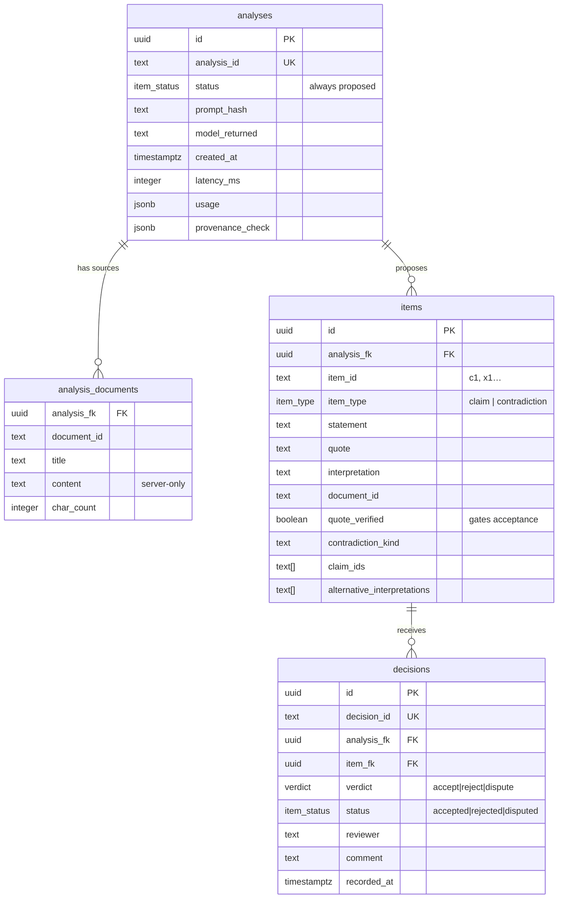

# Supabase — schema and access model

Persistence layer for the hackathon workflow: analyses, source documents,
proposed items, and **append-only human decisions**. The demo keeps working
with its local JSONL store when Supabase is not configured; this is the path
that makes the registry durable and readable by the static frontend.

## Access model (why the publishable key is safe in the browser)

| Role | Key | Can do |
|---|---|---|
| `anon` / publishable | safe to ship in the frontend | `SELECT` on `registry_public` **only** — accepted items with provenance. No source documents, no proposals, no writes |
| `service_role` | server only, never in the browser | insert analyses/documents/items; call `record_decision()`; bypasses RLS by design |

RLS is enabled on every base table with **no** anon policies, so the API
role is denied by default. The one public surface is the definer view
`registry_public` (owner `postgres`), which exposes accepted rows and
nothing else. Table privileges are also revoked from `anon`/`authenticated`
as a second layer.

## Rules enforced in the database (not only in the app)

- A fresh analysis is always `status = 'proposed'` (CHECK constraint) — the
  schema cannot create decided knowledge.
- A claim must have a non-empty `quote` and a `document_id`.
- A contradiction must reference at least two claims and carry an explanation.
- `decisions.status` must match `decisions.verdict`.
- Decisions are immutable: a trigger raises on `UPDATE`/`DELETE`. Re-deciding
  inserts a new row; the current status is the latest decision.
- `record_decision()` refuses `accept` when `quote_verified` is false — the
  same 409 rule the UI and the demo API enforce, now enforced by the database.

## Entity model



Views:

- `item_status_current` — latest decision per item (status resolution).
- `registry_public` — accepted items only, without source text. **The only
  thing the frontend reads.**

## Applying the migrations

```bash
# 1. With psql (connection string from Supabase → Project settings → Database)
psql "$SUPABASE_DB_URL" -v ON_ERROR_STOP=1 -f supabase/migrations/0001_schema.sql
psql "$SUPABASE_DB_URL" -v ON_ERROR_STOP=1 -f supabase/migrations/0002_rls_and_rpc.sql

# 2. Or with the Supabase CLI (linked project)
supabase db push

# 3. Or paste each file into the Supabase SQL editor, in order.
```

Both files are idempotent (guarded `create type`, `create table if not
exists`, `create or replace`, `drop trigger if exists`), so re-running them
is safe.

Optional: install a driver to apply them from this repo without `psql`:

```bash
pip install pg8000
python scripts/supabase_migrate.py        # reads SUPABASE_DB_URL from env
```

## Environment

No secrets are committed. Set these locally (`.env` is gitignored):

```ini
# Public: safe in the browser
SUPABASE_URL=https://<project>.supabase.co
SUPABASE_ANON_KEY=sb_publishable_...

# Server only: bypasses RLS, never expose to the frontend
SUPABASE_SERVICE_ROLE_KEY=...

# Migration only: full Postgres connection string (contains the DB password)
SUPABASE_DB_URL=postgresql://postgres:<password>@db.<project>.supabase.co:5432/postgres
```

The frontend page (`web/portal/registry.html`) reads accepted knowledge with
the publishable key; the key can also be supplied per visit:

```text
/web/portal/registry.html?supabase_url=https://<project>.supabase.co&supabase_anon_key=<publishable key>
```

## Writing from the backend — WIRED

`mock_fen_api/supabase_registry.py` connects with `SUPABASE_DB_URL` (server
secret, never shipped to the browser) and the demo API now writes through:

- `POST /analyze` → `analyses` + `analysis_documents` + `items` (status is
  `proposed` by construction — the schema forbids anything else);
- `POST /decisions` → `select record_decision(...)`, i.e. the governed SQL
  function, so the accept-lock and immutability are enforced by the database
  too; the response gains `supabase_persisted: true|false`;
- `GET /registry` → reads `registry_public` from Supabase when configured, and
  falls back to the local JSONL store if the database is unreachable. The
  response says which one answered: `"source": "supabase" | "local"`.

Behaviour without `SUPABASE_DB_URL` is unchanged: local JSONL/in-memory only,
which is what the offline test suite exercises (a fake registry is injected).

Verified live on 2026-10-31: a real `POST /analyze` through the demo API created
one `analyses` row, two `analysis_documents` rows and four `items` (three
claims, one contradiction), all `proposed`, and `registry_public` stayed empty —
proposals are not knowledge. The verification rows were then removed so the
durable history starts clean.

## Status

- Schema, RLS, RPC, views: applied to the project and verified (rollback-based
  checks: accept-lock, immutability, schema constraints — 7/7 pass).
- Demo API → Supabase writes: implemented and tested (`tests/test_supabase_sync.py`).
- Read-only frontend (`web/portal/registry.html`, `/registry` on Vercel):
  implemented, reads the public view with the publishable key.
- Still open: the first *human* decision has to be recorded from the UI — the
  agent does not create decision records on a person's behalf.
